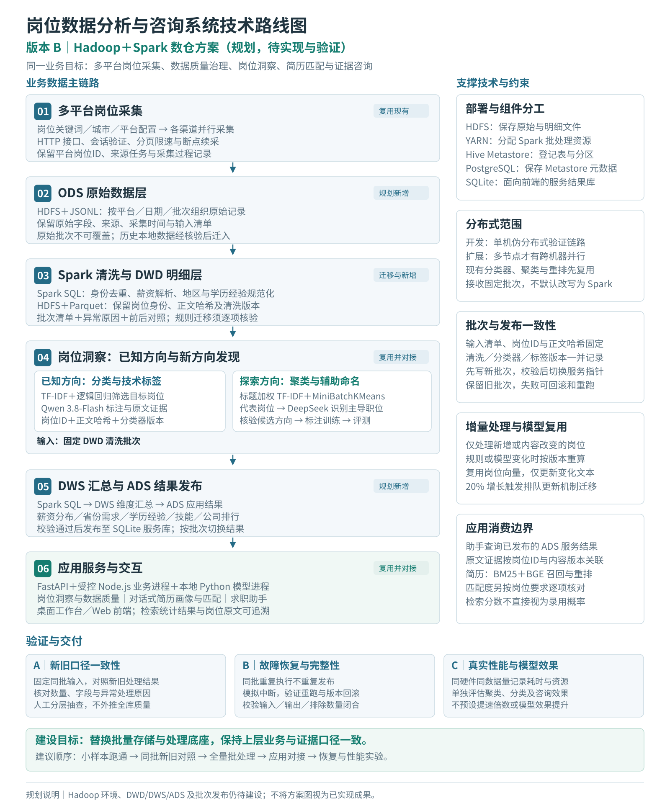

# Hadoop 版建设方案

记录日期：2026-11-20。

状态：规划。本轮仅创建 `version/hadoop`，保存路线图和实施协议；未安装 Hadoop、Spark、Hive 或 PostgreSQL，未更换生产后台，也未迁移生产数据库。

## 基线与隔离

- 共同源码基线：`e20dec3`，本地版保存在 `version/local`。
- Hadoop 工作目录：`E:/Codex/work/20261120-job-hadoop`。
- 当前生产源码目录继续使用 `version/local`；现有数据库、登录资料、采集断点和服务端口沿用原位置。
- Hadoop 新运行数据、模型中间结果及测试产物在后续任务独立指定 E 盘目录，不从本 worktree 自动读取或覆盖生产路径。
- Hadoop 版在完整验收前不合并到本地运行分支。公共业务修复通过独立提交审阅后选择性同步。

## 目标链路

```text
现有采集任务
    ↓ 原始批次导出与清单
HDFS / ODS / JSONL
    ↓ Spark SQL 清洗与身份合并（YARN 调度）
HDFS / DWD / Parquet
    ├─ 既有岗位分类、标签与聚类模块（固定批次输入）
    └─ 质量、薪资与维度统计
    ↓ Spark SQL
DWS 维度汇总 → ADS 应用结果
    ↓ 校验完成、发布新的服务批次
SQLite 服务结果库
    ↓
FastAPI / Node.js → 岗位洞察、简历匹配、求职助手
```



HDFS 负责文件存储，YARN 负责计算资源调度，Spark SQL 负责清洗与汇总。Hive Metastore 只登记表结构和分区；PostgreSQL 保存其元数据，不与岗位应用数据库混为一谈。初期复用现有本地分类、聚类、向量与重排程序，不能据此声称模型也已分布式执行。

## 批次协议

开始迁移前先建立显式协议，后续代码与测试应使用相同字段。

| 字段 | 含义 |
| --- | --- |
| `batch_id` | 不可变的输入批次标识 |
| `source_revision` | 本地导出时的知识库版本或采集批次版本 |
| `source_manifest` | 输入文件、行数、内容摘要与来源任务清单 |
| `platform`、`job_id` | 平台岗位身份，沿用现有平台别名规范化 |
| `job_key` | 复用现有岗位身份算法，不在迁移中重新随机生成 |
| `content_hash` | 复用现有原文内容版本；迁移前先核验序列化一致性 |
| `collected_at` | 可靠采集时间；历史缺失时为空并记录原因 |
| `rules_version` | 规则语义版本及实现摘要 |
| `classifier_version` | 分类器版本、文件摘要和阈值 |
| `label_version` | 标签规范及其输出版本 |
| `model_version` | 向量、重排等模型标识及模型文件摘要 |

原始数据、明细、汇总和应用结果分别记录输入及输出清单。同批重跑不能覆盖已发布内容；新一轮重算写到新的运行目录，以批次或运行标识引用。

## 层次与数据口径

### ODS

保存原始字段、平台、岗位ID、来源任务、可靠采集时间和批次。不覆盖原始发布数据。历史数据迁入时记录来源，无法恢复的历史采集时间、入库处理数量不猜测补零。

路径规划为 `ods/jobs/platform=<平台>/ingest_date=<日期>/batch_id=<标识>/`。控制文件数量并验证清单，避免每条岗位生成一个小文件。

### DWD

清洗后以 Parquet 存储，保留原始值及规范化字段。现有薪资规则中的日薪按21.75天折算、月薪区间中点、面议不填0、学历经验未知与不限区分，都须用同一输入逐项对照后再接入。

身份相同的发布记录按固定批次内可核验的版本关系选取，不用不稳定的随机去重。不同ID但共用正文的记录只进入重复核查，不自动跨地区或跨招聘条件合并。

### DWS 和 ADS

DWS 按岗位方向、省份、学历、经验、技能、公司等维度汇总。ADS 生成前端需要的报告数据、排行榜和可检索服务结果。每个图表记录实际参与统计的样本数与缺失排除量。

模型输出按 `job_key + content_hash + 模型/规范版本` 关联，不把历史正文标签误贴到新正文，也不把聚类候选名称直接当已发布岗位类别。

## 增量与发布

1. 新增、正文变化与规则版本变化分别检测。模型版本变化时，只在对应模型空间重算，旧向量不混入新空间。
2. 保留20%数据增长触发报告排队更新的业务机制；首次分析与分类器版本变化按现有独立条件触发。
3. 写新的明细、汇总与服务结果批次，校验行数、摘要、必需字段和版本完整性。
4. 服务库中的结果与活动批次指针在受控事务内发布，读者按同一已发布批次查数。
5. HDFS 文件写完不等于应用发布成功；若服务发布失败，不切换活动指针，保留此前成功批次。
6. 失败后可重跑与回滚；发布过程须验证重复请求的幂等性。

## 环境选择

开发阶段可在受控 Linux 环境以单机伪分布式验证 HDFS、YARN 与 Spark。不能用单机结果声明多节点加速或高可用。真正多节点环境另行明确机器、网络、资源与版本，记录扩展前后数据量及硬件条件。

具体组件版本、容器镜像和启动配置在下一轮环境实施时锁定，经兼容性核验后记录；本方案不使用尚未核验的配置冒充可运行部署。

## 后续里程碑

| 阶段 | 交付与验收 |
| --- | --- |
| M1：固定小样本 | 导出清单、版本信息与脱敏测试样例；清单和输入数量一致 |
| M2：存储批处理 | ODS → Spark → DWD 能在目标环境实际运行，并验证不重复发布 |
| M3：规则一致性 | 同批新旧字段及异常原因对照；差异逐项解释，分层人工抽查 |
| M4：模型与结果 | 固定 DWD 对接现有模型，生成 DWS/ADS 与服务发布结果 |
| M5：应用闭环 | 相同批次贯通报告、简历检索和助手引用，证据能够回到原文版本 |
| M6：恢复与性能 | 模拟失败、重跑及回滚；同硬件同输入记录耗时、内存和读写量 |

不预设提速比例、分类效果改善或开发工期。模型实验与底座迁移实验分开记录，不能将输入或样本差异归因于 Hadoop。

## 完成标准

仅在 M1—M6 的必要验收有真实记录后，才将本分支称为 Hadoop 可运行版本。目前本地可运行源码仅作为共同起点；本分支新增内容为方案文档和版本说明。
