# 岗位采集与分析控制台 · 图文使用说明

> 2026-10-15 采集策略更新：招聘采集浏览器已禁用，当前只开放已接入的实习僧、国聘直连接口；接口仍可能受限。旧截图中的招聘登录渠道和勾选状态不再代表可用能力，以[纯HTTP说明](纯HTTP接口采集_20261015.md)和运行界面为准。AI标注登录不受本次变更影响。

更新：2026-10-14，返回 [项目首页](../README.md)。截图均为新版前端**只读合成演示**，没有真实账户、任务、简历或聊天；示例数字不代表实际市场或算法效果。

## 1. 启动与入口

首次使用先读 [环境与依赖](../README.md#环境与依赖)，执行 `npm ci`、`npm test`、`npm start`，或双击启动 BAT。默认 <http://127.0.0.1:8765>，已有实例可能是 8788，以终端输出为准，不要对同一目录重复启动。

只看界面：`npm run docs:demo`，打开 <http://127.0.0.1:18979>。演示按钮不能执行业务，只有合成会话回放可读取。

| 入口 | 作用 |
| --- | --- |
| 采集中心 | 创建、有界并发、进度/日志、暂停续采、可选下载 |
| 平台登录 | 人工登录和验证，受管理浏览器会话 |
| AI 打标 | 快照/文件结构化标签、证据复核 |
| 岗位洞察 | 筛选岗位、画像、同条件招聘薪资 |
| 求职助手 | 多会话、岗位证据、简历匹配、采集确认工具 |

## 2. 平台登录

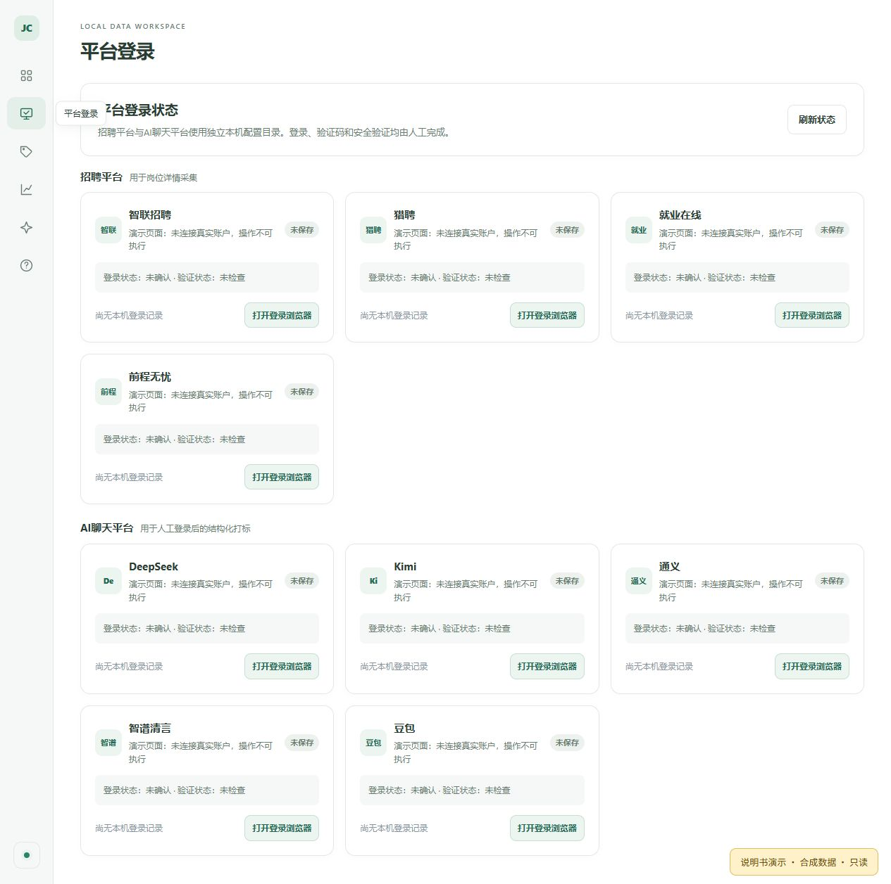

打开对应浏览器，由本人登录/验证。会话仅存本机，不上传。遇到滑块、401/403/429、限流或结构变化，保留断点并暂停/跳过受阻渠道，不自动绕过。

BOSS 和鱼泡已停止新请求；前程无忧重新接入正常浏览器会话但不保证持续可用。登录入口/历史适配器存在不等于任务可用，以当前可用性校验为准。

## 3. 创建与运行任务

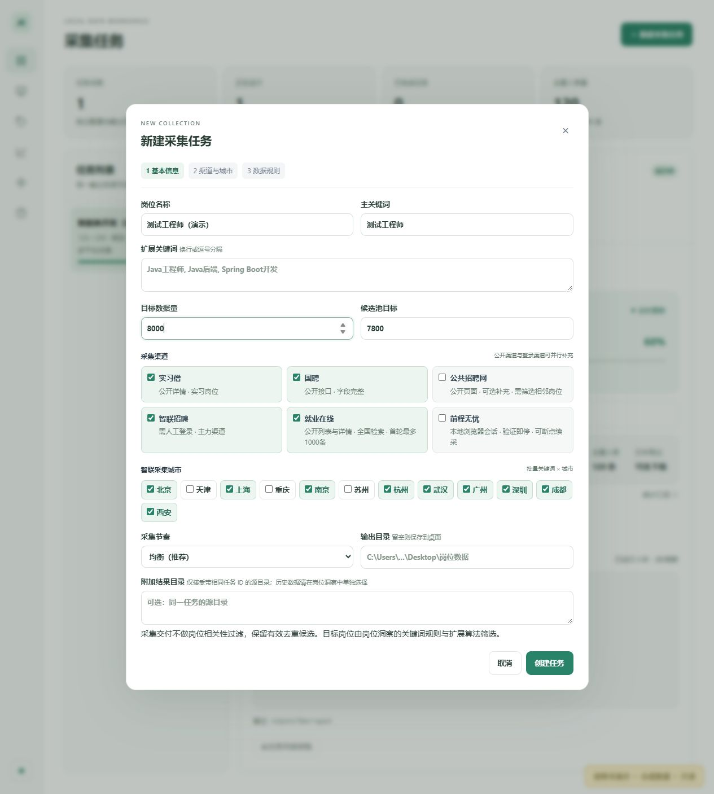

填写岗位、实际关键词、目标、城市、渠道、节奏及可选目录。任务显示标签不混入搜索关键词，例如“测试工程师-北京-8000”不应成为额外查询。

渠道有界并发，同账号串行；成功详情缓存复用。低新增监测只调整已配置采集条件，不改变岗位含义、不把错误页面当作零需求。

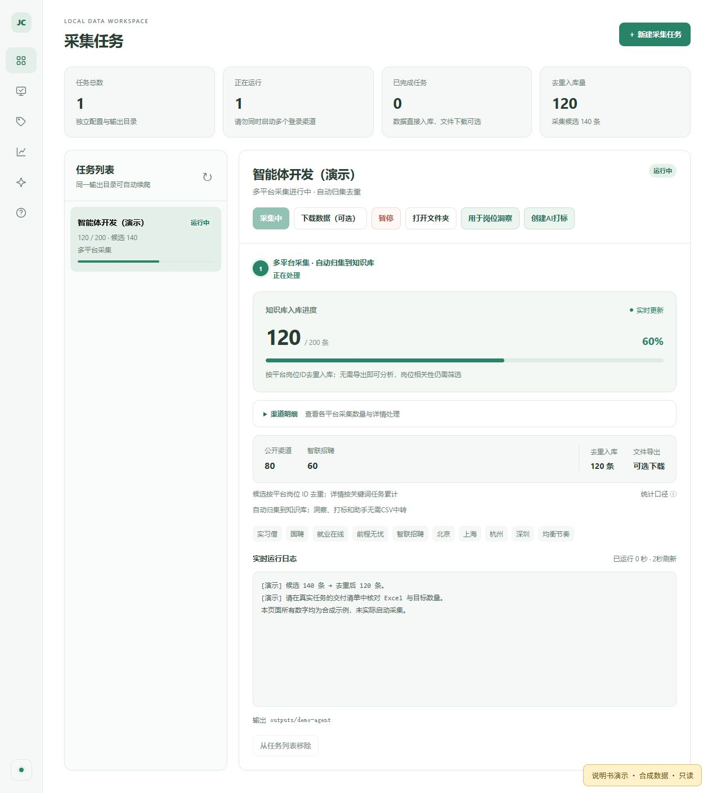

主进度按平台岗位 ID 去重入库。展开渠道明细查看候选和详情次数：后者按关键词任务累计，可重复，不等于独立岗位数。缺少计数时不显示虚构百分比。日志约 2 秒刷新，知识库约 15 秒归集。

目标不保证交付。资源不足、访问限制、正文缺失或需求不足均可能未达目标。暂停后原任务断点续采，不另建同名任务替代。

## 4. 知识库直连与可选下载

采集 → 任务 SQLite → 中央 SQLite/WAL → 洞察/打标固定快照 → 助手工具。保留内容版本和任务归属；仅平台＋岗位 ID 精确去重，不保证跨平台实体归一。

点击任务“用于岗位洞察”选择 `kb://task/<任务ID>`，或选择全部知识库。未完成采集也可分析，不需先导出 CSV。

需要文件时“下载数据（可选）”覆盖更新本任务最新文件，原始资料和断点保留。提交回执不是导出完成；请核对状态、条数与警告，CSV 成功而 Excel 失败会提示部分完成。

## 5. AI 打标（可选）

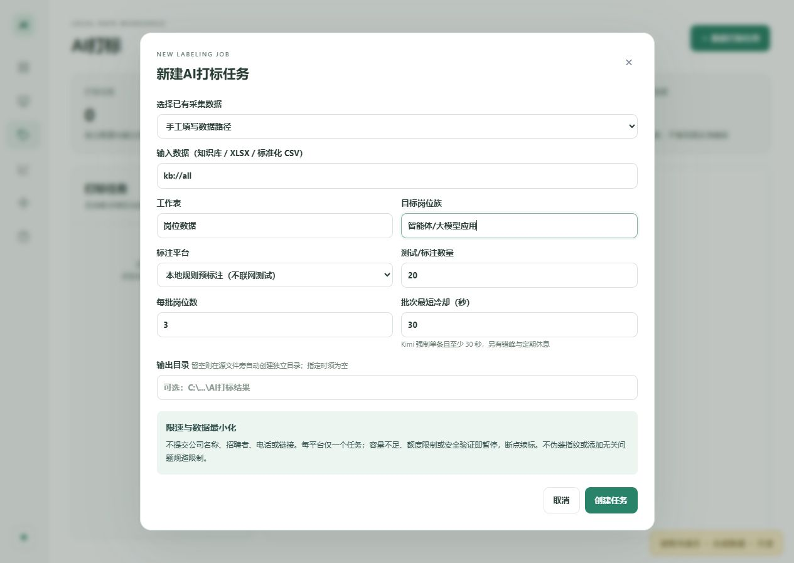

选择知识库或手工文件，填写岗位族、平台和批次。规则与模型来源分开；只有岗位键、内容版本、标签摘要一致且证据真实包含于正文的人工批准标签反馈知识库。待复核不进入助手主统计。基础洞察不强制要求打标，外部平台可能收费或受限。

## 6. 全量洞察、词云与薪资

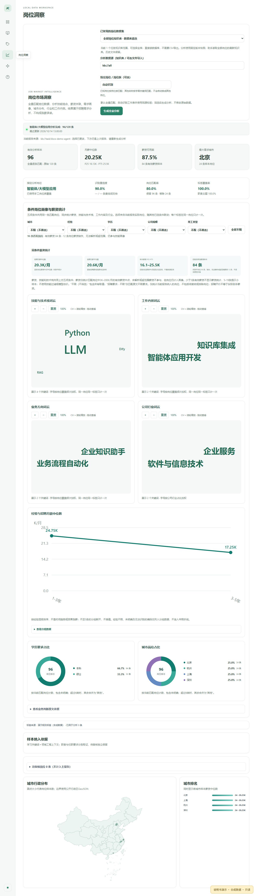

选择数据库或兼容 XLSX/CSV，指定岗位/岗位族，生成全量分析。“全量”是读取后逐条筛选，不表示所有候选都相关；其他名称按字面匹配，不自动换岗位。嵌入式增加标题/正文证据规则，缺乏证据仍明确报错。

报告输入为固定版本快照，采集更新后需重新生成。

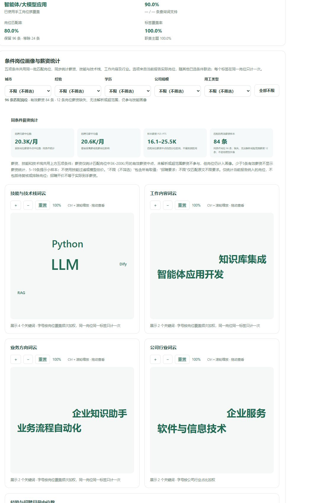

城市、经验、学历、规模、用工默认不限，选项来自报告并联动；筛选“不限”不等于原文“经验不限”。

技能/技术栈、工作内容、业务方向、公司行业四类词云：高权重词居中，向外字号/权重递减。工具栏放大、缩小、重置和单图打开；Ctrl＋滚轮可缩放单图。词频不是薪资因果效应。

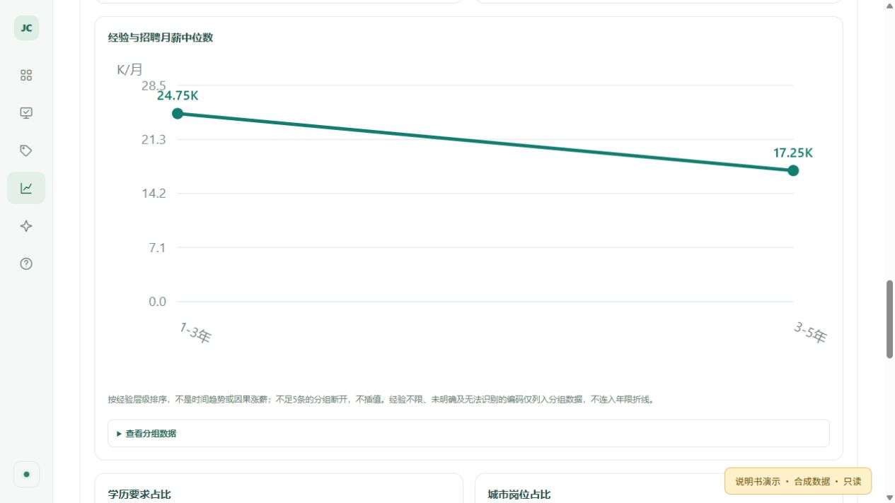

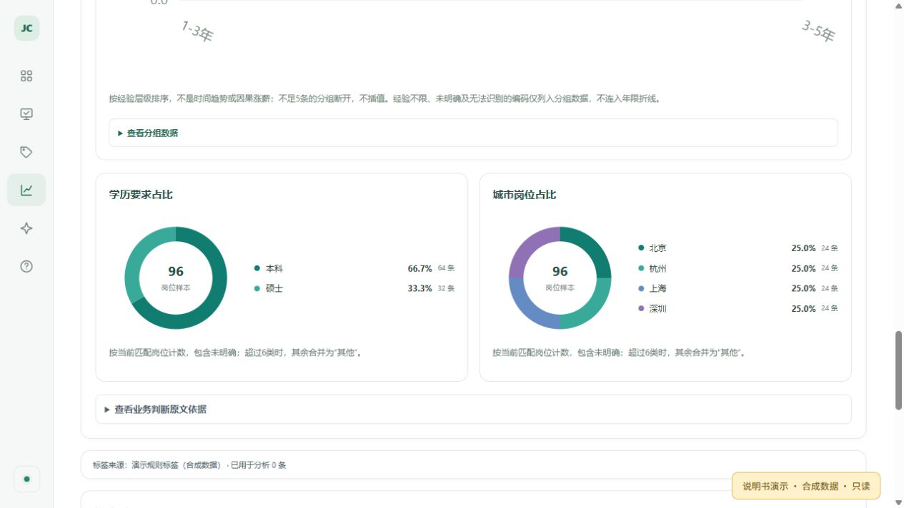

经验折线按有效招聘薪资统计，样本不足保留缺口，不补造。学历与城市环状图包含未明确，尾部合为其他；分母为当前匹配岗位数。

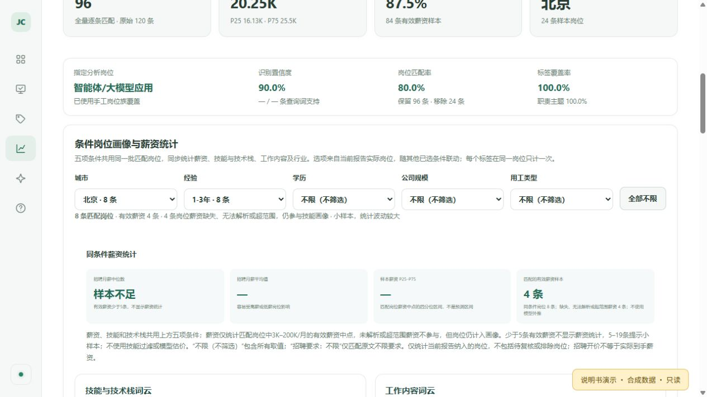

招聘月薪中点取 3K–200K/月有效区间，少于 5 条不报分位，5–19 条小样本提示。统计不代表个人可获得薪资。

独立关键词模块、多技术栈组合表已移除，技术—薪资增量非负回归不再展示；保留同条件薪资统计，不承诺学习技术必然涨薪。

## 7. 求职助手与简历

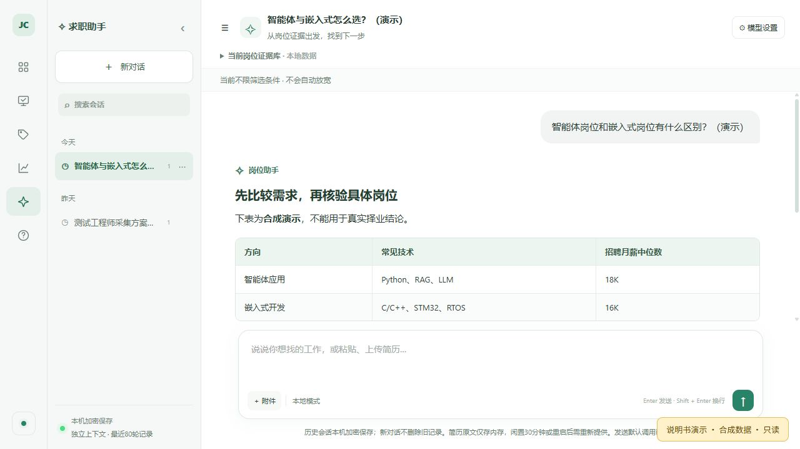

左侧新建、切换、搜索、重命名会话；删除后可撤销，手机用抽屉。安全 Markdown 支持标题、表格、列表与证据引用；回答生成期间不切换。

直接问岗位需求、城市经验学历条件、智能体与嵌入式比较或前两个岗位。读取全部有效活动任务，不依赖当前单个洞察报告；无目标方向数据不借用其他岗位补齐。

简历聊天粘贴（推荐“简历：”开头）或“＋ 附件”：TXT/MD/文字 PDF/DOCX，最多 3MB、40000 字、PDF 40 页。扫描件/图片/旧 DOC 暂不支持。原文仅存服务内存，闲置 30 分钟或重启失效；标签覆盖率不是录用概率。

右上“模型设置”弹窗本机填写供应商、可用模型 ID 与新密钥，Windows DPAPI 加密，不在聊天发送或入 Git。模型外发脱敏最近上下文、技能和少量证据；普通聊天仍可能含未识别隐私。调用可能收费；未配置可用本地规则。见 [助手详细说明](求职助手_使用说明.md)。

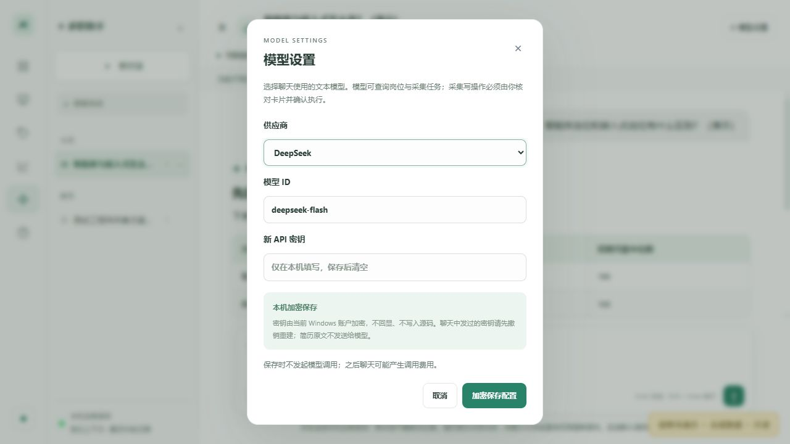

## 8. 聊天操作采集

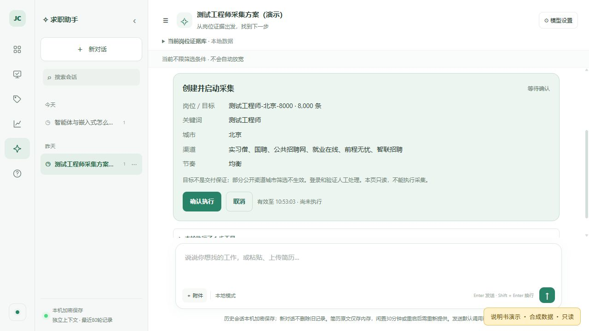

可问任务列表 → 最新进度/日志 → 准备续采；创建示例：“创建北京测试工程师任务，目标8000条并启动”。

先返回方案卡，列出岗位、关键词、城市、渠道、目标及警告，**尚未执行**。必须点击“确认执行”；聊天“确认并采集”只定位本会话方案，过期重新校验并准备新卡，仍需按钮确认。

有效期 10 分钟，会话和任务状态绑定。取消/已结束不能复活；多方案不得猜测。重复点击返回已有回执，结果不确定先查状态/日志，不自动重试。错误保留真实脱敏原因，任务列表不能代替操作成功回执。

已接通创建、启动/续采、暂停、可选下载；洞察/打标写操作尚未开放给助手。不支持任意命令、自动投递、联系招聘者、自动登录或破解验证。

## 9. 升级与排障

升级前核对采集/打标/洞察均空闲，备份 `ui_data/`、任务数据库和私有配置后人工重启。GitHub 更新不代表旧进程重载。

- 接口不存在：确认加载新后端，不能只刷新前端；新版已内置助手。
- 兼容独立助手：默认 8791，连接旧主端口 8788；主服务为 8765 时设置 JOB_UI_PORT。
- 无岗位/薪资：检查目标证据、正文、待复核状态、有效薪资及筛选，不虚构补齐。
- 文件依赖缺失：数据库路径无需 artifact-tool，XLSX/CSV 读写及 Excel 导出仍需要非公开组件。
- 模型失败：本地真实结果保留，不宣称模型完成。
- 资源/验证/占用：保留断点，人工处理后原任务续采。

更多：[后端知识库设计](统一岗位知识库_后端设计.md)。截图验证展示，不证明真实渠道可访问或分类准确率。
