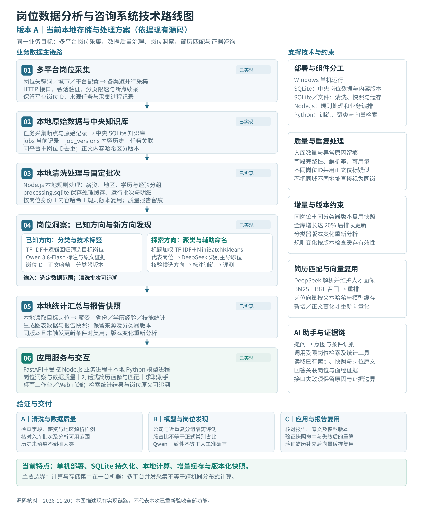
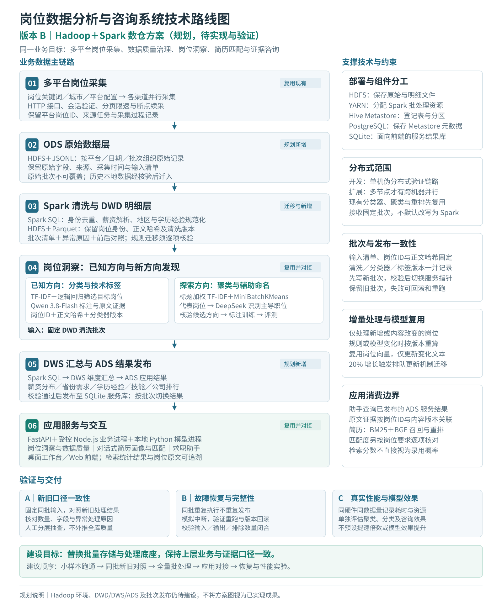

# 本地版与 Hadoop 版

本仓库通过两个长期分支管理同一系统的不同数据底座，保留共同历史，不复制成两个互不关联的仓库。

| 分支 | 用途 | 当前状态 |
| --- | --- | --- |
| `main` | 既有发布历史 | 保持现有远端内容；后续验收完成再合并 |
| `version/local` | Windows 单机、SQLite 和本地处理版本 | 当前源码基线；继续维护现有应用 |
| `version/hadoop` | HDFS、Spark、YARN 数仓版本 | 从同一源码基线派生；当前仅保存架构与建设计划 |

建分支并不代表 Hadoop 已实现。运行数据、登录会话、简历、模型缓存和数据库不随源码推送。

## 两版路线图

### 版本 A：当前本地方案



### 版本 B：Hadoop 数仓规划



## 相同业务与不同底座

两版保留多平台岗位采集、岗位分类、方向发现、技术标签、岗位洞察、简历匹配和求职助手。Hadoop 版主要调整原始数据存储、清洗批处理、汇总与应用结果发布。

| 层次 | 本地版 | Hadoop 版目标 |
| --- | --- | --- |
| 原始数据 | 任务存储、中央 SQLite、内容历史 | HDFS 上不可覆盖的 ODS JSONL 批次 |
| 清洗明细 | Node.js 规则与 `processing.sqlite` | Spark SQL 清洗与 DWD Parquet |
| 汇总统计 | 本地进程读取目标岗位并汇总 | Spark SQL 生成 DWS、ADS |
| 服务结果 | SQLite、报告和索引快照 | 校验后发布至 SQLite 服务库 |
| 模型计算 | 本地 Python 分类、聚类、召回与重排 | 初期继续复用；用固定 DWD 批次对接 |
| 元数据 | SQLite 业务表与批次清单 | Hive Metastore 登记表；PostgreSQL 保存其元数据 |

Hive Metastore 不是独立的 PostgreSQL 岗位库。单机伪分布式用于验证组件链路，多节点才有跨机器资源扩展；不预设迁移后更快。

## 日常开发

当前生产源码目录保持在 `version/local`。Hadoop 版使用 E 盘独立 worktree；不要为了比较代码，在运行目录频繁切换存储实现。

```powershell
git status --short
git branch -vv
git worktree list
git fetch origin
git log --oneline --left-right version/local...version/hadoop
git diff version/local...version/hadoop
```

两个分支共享采集、前端或助手修复时，优先将修复做成独立提交，检查后使用 `git cherry-pick <commit>` 应用到另一分支，再运行对应测试。不要直接整分支互相覆盖，否则容易把存储方案混在一起。也不要用 `git reset --hard` 清空正在运行的工作目录。

在 GitHub 中用 Pull Request 审阅差异。Hadoop 专有存储模块在通过验收前不合入本地版或 `main`；创建版本标签时只标记已确认的提交。后续本地版继续更新，也不会自动更新 Hadoop 分支。

## Hadoop 版交付顺序

1. 固定输入清单：平台、岗位ID、原始字段、采集来源、正文哈希及批次。
2. 小样本进入 HDFS ODS，Spark 读取、清洗并写 DWD。
3. 对照现有规则，核验身份合并、薪资单位、地区、学历经验及异常记录。
4. 同一 DWD 批次对接既有分类与方向发现，生成 DWS、ADS。
5. 先写新结果，校验完成再切换 SQLite 服务结果的批次指针；旧批次保留。
6. 验证重复执行、中断重跑、回滚、版本失效与真实规模耗时。

## 两版共同的数据约束

- 同平台＋岗位ID识别发布记录；不同ID共用正文仅标记疑似重复，不能直接删除不同地点的岗位。
- 岗位身份、正文哈希、清洗规则、分类器及标签版本都要可追溯。
- 新增或正文改变才更新对应岗位向量；向量模型变化则在新模型空间重算。
- 同岗位、同分类器版本的既有报告满足复用条件时读取旧快照；全库增长达20%排队更新；首次分析、版本变化等按现有失效规则处理。
- 候选簇名不直接成为正式类别，簇占比不能当正式岗位类别占比。
- Qwen 标签一致性与人工准确率区分；检索、重排分数与岗位要求覆盖率区分。
- 两版比较固定同一批输入和同一统计口径，不把不同批次或不同样本量的结果直接比较。

## 本次基线核验

日期：2026-11-20。当前图依据现有源码绘制，不代表所有功能重新做过端到端验收。

- 桌面路由与缩放、质量报告、原始数据、清洗批次和模型用量相关 Node.js 测试：29 项通过。
- FastAPI 后端测试：26 项通过；岗位向量增量缓存测试：12 项通过。
- 源码提交前执行现有源码安全检查，排除数据库、凭据、会话与运行产物。
- Hadoop 组件尚未部署、没有性能实验结果；本次图示不作已完成成果声明。
