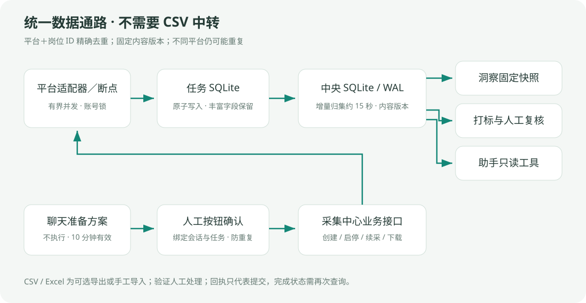

# 统一岗位知识库与数据通路

## 已落地的数据通路

```text
招聘平台适配器／断点
         ↓ 任务ID与目录归属校验
任务 SQLite（平台＋岗位ID去重，保留更完整字段）
         ↓ 增量归集，约15秒；历史任务交付文件一次性导入
统一岗位知识库 SQLite / WAL
         ├─ 岗位事实＋不可变内容版本＋采集任务来源
         ├─ 原文规则岗位分类（include / review）
         ├─ 打标结果＋人工复核状态＋标签摘要＋内容版本
         ├─ 固定版本分析快照 → 洞察 → 分岗位分析记录
         └─ 全岗位检索、薪资统计、简历匹配、跨岗位对比工具 → 聊天Agent
```

正式控制台启动的可用公开渠道、智联批量适配器直接写任务数据库，不再默认生成渠道CSV、统一CSV或最新CSV；实习僧/就业在线未完成渠道时仍由原有详情断点增量归集。鱼泡和BOSS已停止新请求，保留适配器仅供历史兼容，不属于可用默认渠道。旧命令行脚本未启用原生入库模式时继续兼容旧输出。采集流水线结束直接完成入库，不再强制运行合并文件和Excel导出阶段。下载数据按钮是可选的兼容文件出口，不再影响洞察或助手可用性。



数据库：`ui_data/knowledge/岗位知识库.sqlite`。任务库：原任务目录内`统一采集数据.sqlite`。SQLite使用本机进程间锁和事务，中央库开启WAL；任务写入批次原子提交。中央库与各任务数据库不是跨库分布式事务，而是可重复、可恢复的增量同步；不承诺采集成功到助手可读之间零延迟。

## 实体与版本

- `jobs`：全库稳定岗位键K＋24位摘要，平台和岗位ID唯一；当前原始正文、内容摘要、规则观察值。
- `job_versions`：同岗位历史内容版本，防止分析结果错误贴到已更新JD。
- `tasks / memberships`：岗位可以来自多个任务，只计一条岗位事实，保留各任务归属；任务归档后不出现在默认活动范围，数据不删除。
- `sources`：来源文件的大小、修改时间签名，未变化则跳过解析。已有目录必须有正确任务归属，不扫描宽泛历史目录或猜测Excel文件归属。
- `labels`：标签绑定岗位键和内容摘要；区分pending、approved、rejected、rule。人工审批摘要必须匹配当前标签，标签证据必须真实包含在岗位正文中才进入分析与助手。
- `snapshots`：分析、打标读取的不可变岗位快照。采集继续更新不会改变既有分析输入。
- `analyses`：每份洞察独立保存岗位族、知识库版本和快照。仅岗位键与内容摘要一致的洞察观察值反馈到助手；不是覆盖全局单一报告作为知识库。

没有按标题相似度强行跨平台去重。不同平台可能发布同一岗位，仍可能影响样本数；目前全库精确去重只保证“平台＋岗位ID”。

## 统一读取接口

- `kb://all`：全部活动任务去重岗位。
- `kb://task/<任务ID>`：任务范围；候选记录不等于全部属于任务名称的目标岗位。
- `kb://snapshot/<快照ID>`：固定版本分析/打标输入。
- `GET /api/knowledge/status`：数据版本与全库岗位量。
- `GET /api/knowledge/datasets`：各任务可选知识库范围。
- `GET /api/knowledge/tasks/<任务ID>/source`：任务按钮直达知识库输入。
- 洞察与打标继续使用原接口，但输入支持知识库URI，内部固定快照，无需CSV导出。
- 助手上下文返回全部岗位方向；每轮通过岗位检索、市场统计、跨方向比较等只读工具访问真实事实。

控制台和独立助手服务共用同一个数据层。模型、向量库不是SQLite读取的前置要求；未配置模型仍可通过本地规则调用工具。目前检索为关键词加权＋结构化过滤，没有部署embedding/向量库，不能称为已完成语义向量RAG。

## 比较方法和边界

跨岗位比较返回相同筛选条件下的岗位量、有效薪资数、招聘月薪中位数、25%–75%分位、技术出现频率和可引用JD。默认排除日/时薪折算样本；有效薪资少于5条不发布薪资分位。同城市、经验、学历、用工类型的每侧有效薪资至少5条时，再提供分层对比；没有可比较分层就明确指出。

“技能数量”不是学习难度，“月薪÷技能数量”不是性价比。现有数据不支持证明技能因果涨薪、个人录用概率或决定哪个方向必然更划算。岗位分类包含自动原文规则，尚未对所有方向完成独立人工准确率验收；review记录不进入助手统计。平台和招聘时期覆盖也可能不同，应抽查证据后解释。

## 迁移与部署

历史文件未删除、不覆盖原始资料；只有已登记且归属正确的任务数据导入。空任务仍保持空，不从其他目录借用数据填满。已采集候选、规则分类可用岗位、实际洞察纳入记录是三个不同口径，界面必须分别说明。

服务升级前核对无活动采集/打标/分析，升级服务和归集工作进程，不触碰招聘浏览器与登录会话。新数据库需要备份；后续应加入内容保留策略、数据库迁移版本与索引评估，避免长期保留所有分析快照无限增长。

测试：`test_collector_native_sink.mjs`、`test_job_knowledge_store.mjs`、`test_knowledge_native_analysis.mjs`、`test_knowledge_console_api.mjs`，以及原助手、统一去重与可选文件导出回归测试。控制台接口测试使用独立临时数据目录和本地测试端口，贯通任务知识库输入、全量洞察和本地规则打标启动，不启动采集浏览器或外部模型；测试环境通过 `JOB_UI_START_WORKER=0` 关闭周期归集。生产默认仍开启归集工作进程。真实供应商模型调用仍需用户在本机配置新密钥后验证。
